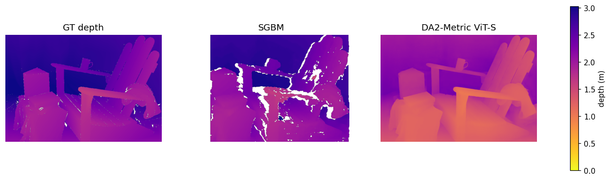

# stereo-depth-eval — 双目/单目深度估计精度评测

用标准双目数据集 + 真值，量化评测「模型输出的距离 vs 真实距离」。
目标场景：宇树 G1 机器人头部双目相机的测距精度验证（几何基线 → 学习双目 → 单目米制模型三路对比）。


## 当前结果（Middlebury 2014 Adirondack-perfect, 深度以米为单位统一口径）

| 模型 | 类型 | AbsRel(mean) | AbsRel(median) | MAE | δ1 | EdgeDisagree |
|---|---|---|---|---|---|---|
| SGBM (OpenCV) | 双目几何 | 1.55% | **0.32%** | **4.0 cm** | **98.2%** | 6.8% |
| DA2-Metric ViT-S (Hypersim) | 单目米制 | 29.81% | 29.23% | 70.3 cm | 22.0% | 81.2% |

> 真值深度范围 1.62~3.07m。结论与 [arXiv 2610.27199](https://arxiv.org/html/2610.27199v1) 的 Orin 横评一致：
> 双目几何比单目米制准 1~2 个数量级；单目模型在域外场景（本数据集为户外林地，模型用室内合成数据训练）
> 出现明显尺度漂移（整体预测偏近，见图）；单目的优势是无需标定、无弱纹理空洞。
> 视差口径的历史评测记录见 `outputs/results.md`。



## 快速开始

```bash
# 环境: Python 3.11+ (项目在 3.11 / OpenCV 5.0 下开发)
pip install -r requirements.txt

# 1. 下载数据 (Middlebury 2014, ~35MB, 已配代理环境可直接下)
python scripts/download_middlebury.py

# 2. 跑 SGBM 测距管线, 输出视差图/深度图到 outputs/
python src/sgbm_depth.py

# 3. 对真值评测, 指标追加到 outputs/results.md
python src/evaluate.py

# 4. (Task2) 单目米制模型对比: 先下载权重 (~99MB, 国内走 hf-mirror)
curl -L -o models/depth_anything_v2_metric_hypersim_vits.pth ^
  https://hf-mirror.com/depth-anything/Depth-Anything-V2-Metric-Hypersim-Small/resolve/main/depth_anything_v2_metric_hypersim_vits.pth
python src/evaluate_mono.py    # SGBM vs DA2 vs 真值 三方对比, 输出 compare_depth.png
```

需要 torch（CPU 版即可，`pip install torch --index-url https://download.pytorch.org/whl/cpu`）。

## 项目结构

```
├── scripts/download_middlebury.py   # 数据下载
├── src/
│   ├── sgbm_depth.py                # SGBM 测距管线 (标定解析/视差/深度/可视化)
│   ├── mono_depth.py                # 单目米制模型适配层 (DA2-Metric ViT-S)
│   ├── eval_metrics.py              # 统一指标库: AbsRel/MAE/δ1/边缘离散率 + PFM 解析
│   ├── evaluate.py                  # SGBM vs 真值, 结果落 results.md
│   └── evaluate_mono.py             # 单目 vs SGBM vs 真值 三方对比
├── third_party/depth_anything_v2/   # DA2 官方模型代码 (Apache-2.0, 已内嵌)
├── models/                          # 权重 (gitignore, 见快速开始)
├── data/                            # 数据集 (gitignore, 用脚本下载)
├── outputs/                         # 结果图 + results.md 评测记录
└── notes/                           # 学习/复盘笔记
```

## Roadmap

- [x] Task 1 — SGBM 几何基线 + 真值评测闭环
- [x] Task 2 — 单目米制模型接入（Depth Anything V2 Metric ViT-S）+ 三方对比
- [ ] Task 3 — 多模型统一评测扩展（IGEV / Lite Any Stereo / DA3, 边缘指标校准）
- [ ] Task 4 — G1 机器人实测协议（标定 → 分距离点实测 → 误差曲线）

### 关键技术笔记

- 双目深度误差 δZ = Z²·σd/(f·B)：G1 小基线（~6cm）在 3~4m 外撑不住厘米级精度；
- `cv2.resize` 只重采样像素、不缩放数值——视差/焦距/doffs 等像素量缩放后必须手动等比换算；
- `StereoSGBM.compute()` 输出 int16 定点数，真实视差 = 值/16；
- 单目米制模型换分辨率会发生尺度漂移（arXiv 2610.27199），评测时锁定分辨率。

## 数据与许可

数据来自 [Middlebury Stereo Dataset 2014](https://vision.middlebury.edu/stereo/data/)（学术用途），
不入库，通过脚本下载。
